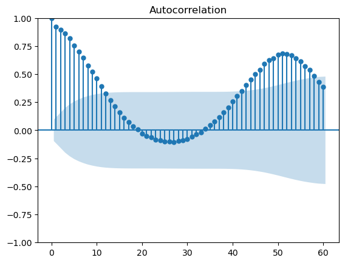
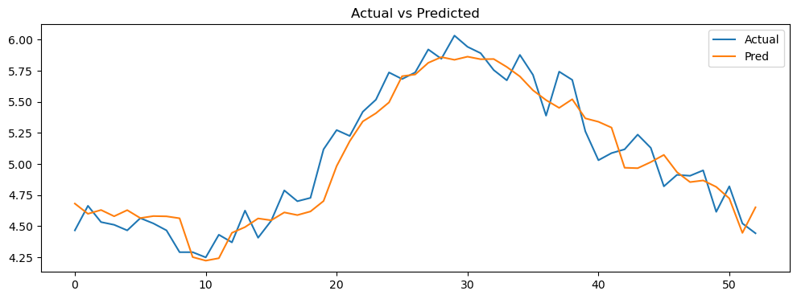
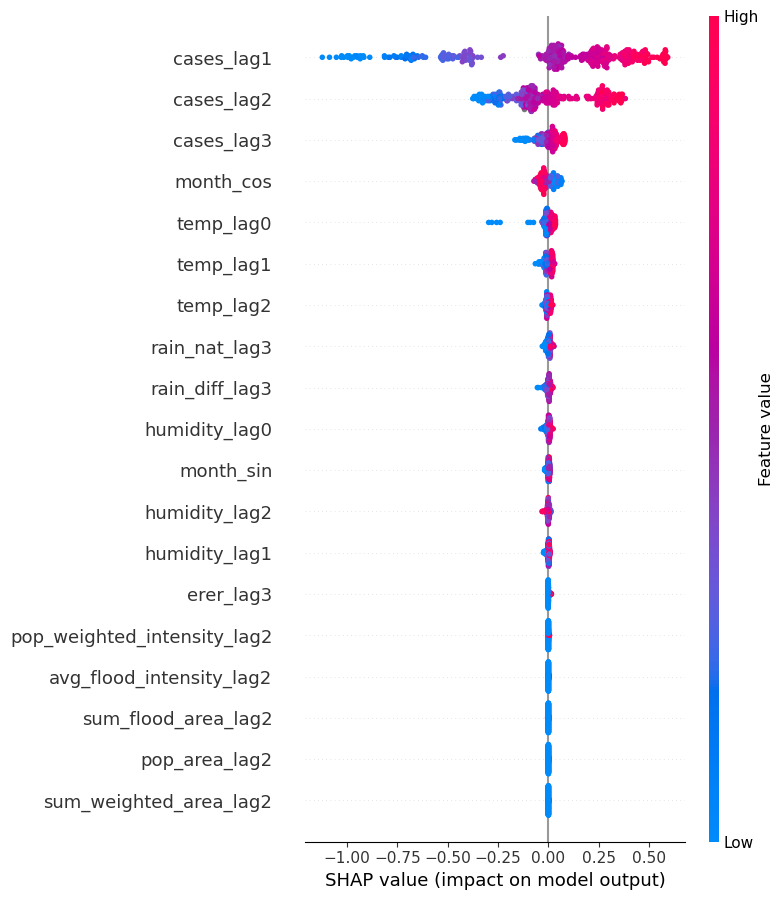
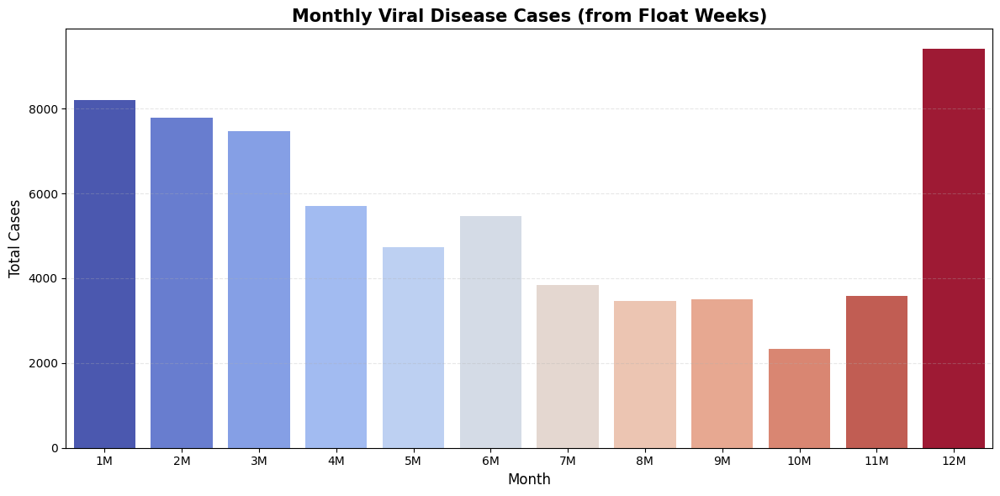

# Heavy rain and waterborne disease

Team project from the KUBIG ML study. The question was whether heavy rain and flooding increase
waterborne infectious disease in Korea, once you account for seasonality and the fact that case
counts are strongly autocorrelated. This repo has the bacterial and viral analysis notebooks.

## Data

Weekly data merged on (year, week):

- case counts for bacterial, viral and protozoal waterborne diseases
- weather: temperature, humidity, rainfall, extreme rainfall, change in rainfall
- flooding: flooded area, flood intensity, population-weighted flood exposure
- water quality: water temperature, DO, BOD, COD, pH, coliform

The raw data files aren't included.

## Bacterial

Bacterial cases have a clear 52-week cycle and very high autocorrelation, so any rainfall effect has
to be measured on top of that.



I log-transformed the weekly counts and tuned random forest, XGBoost and LightGBM with
`TimeSeriesSplit`. Test RMSE (log scale):

| model | RMSE |
|---|---|
| random forest | 0.159 |
| LightGBM | 0.183 |
| XGBoost | 0.211 |



To see what rainfall adds on its own, I also split the prediction into two parts: a model using only
past case counts, and a second model that predicts its residuals from rainfall and flooding
variables. The final prediction is the sum of the two.

| model | test RMSE (cases) |
|---|---|
| past cases only | 35.45 |
| plus rainfall / flood residual model | 34.53 |

So rainfall and flooding help, but only by about 2.6%. The SHAP plot says the same thing: lagged
case counts are by far the most important features.



## Viral

Viral cases peak in winter, so a plain correlation between rainfall and cases comes out negative.
That's the season, not rain protecting anyone. To deal with this I fit a negative binomial regression
on temperature plus yearly sine/cosine terms, then modeled the Pearson residuals with random forest,
XGBoost and LightGBM and looked at SHAP values.



After controlling for temperature and season, the rainfall effects were mostly not significant. I
think the better next step is to look only at summer, when the extreme rainfall actually happens.

## Files

```
notebooks/bacterial_modeling.ipynb       lag correlations, RF / XGBoost / LightGBM, residual model
notebooks/viral_eda_and_modeling.ipynb   data merge, EDA, negative binomial, residual models, SHAP
figures/                                 plots exported from the notebooks
```
